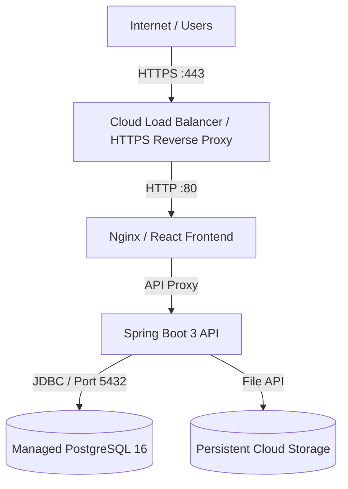

# Production Deployment Architecture & Guidelines

## 1. Cloud Architecture Overview

The application is designed for a standard 3-tier containerized cloud deployment:



### Components
1. **Load Balancer/Reverse Proxy:** Terminates HTTPS, routes traffic, handles TLS certificates (e.g., AWS ALB, Cloudflare, Traefik).
2. **Frontend (Nginx + React):** Serves static Vite build files. Proxies `/api/v1` to the backend.
3. **Backend (Spring Boot):** Stateless Java API. Configured via environment variables.
4. **Database (PostgreSQL):** Authoritative state. Must be a managed service (AWS RDS, GCP Cloud SQL) or persistently volume-mounted.
5. **Storage:** Currently `./uploads` (requires persistent volume mounting in Docker). Planned migration to S3-compatible object storage.

---

## 2. Environment Variables & Secrets

The backend requires the following configuration via environment variables in production. **NEVER commit these to Git.**

```env
# Core Spring Profile
SPRING_PROFILES_ACTIVE=prod

# Managed Database Credentials
DB_HOST=your-db-host.internal
DB_PORT=5432
DB_NAME=business_billing_db
DB_USER=your_db_username
DB_PASSWORD=your_secure_db_password

# Authentication (Minimum 32 random bytes/base64 string)
JWT_SECRET=your_secure_jwt_signing_key
JWT_EXPIRATION_MS=86400000

# CORS & Frontend URL
CORS_ALLOWED_ORIGINS=https://your-production-domain.com

# Storage Configuration
STORAGE_TYPE=LOCAL
STORAGE_LOCAL_DIR=/app/uploads
```

---

## 3. Database & Migrations

**Flyway is the sole mechanism for database schemas.**
- Do NOT use Hibernate `ddl-auto=update` or `create` in production. (The `prod` profile sets this to `validate`).
- The application automatically applies Flyway migrations (`V1` through `V10`) on startup.
- The PostgreSQL database must be seeded manually before first use if the business owner requires a pre-existing dataset, though the application exposes APIs to create products and customers.

---

## 4. Persistent Storage (Files & Documents)

**Important Limitation:** The application currently writes invoice PDFs and uploaded logos to a local directory defined by `STORAGE_LOCAL_DIR` (defaults to `./uploads`).
- In Docker, you **MUST** mount a persistent volume to this directory (e.g., `-v billing_uploads:/app/uploads`).
- If you run multiple backend instances behind a load balancer, they must share this volume (e.g., EFS/NFS), or you must upgrade the `FileStorageService` to use Amazon S3.

---

## 5. Security & HTTPS

- The Spring Boot application exposes HTTP on port `8080`.
- The Frontend Nginx exposes HTTP on port `80`.
- **Do NOT expose these ports directly to the internet.**
- You must place a Load Balancer or Reverse Proxy (e.g., Nginx, Traefik, AWS ALB) in front of the application to provide HTTPS termination and secure headers.
- Cross-Origin Resource Sharing (CORS) is restricted in production. Update `CORS_ALLOWED_ORIGINS` to match your actual frontend domain.

---

## 6. High Availability & Multi-Instance

If scaling the backend to multiple instances (horizontal scaling):
1. **File Storage:** As noted above, `./uploads` must be a shared network drive or migrated to S3.
2. **Rate Limiting:** The login rate limiter currently uses `Caffeine` (in-memory per JVM). If using multiple instances, a user could bypass the rate limit by hitting different instances. Consider migrating to Redis for clustered rate-limiting if this becomes an issue.
3. **Transactions:** PostgreSQL handles all database locking safely across multiple instances. Concurrent payments, inventory allocations, and invoice generations are mathematically safe from race conditions.

---

## 7. Backups and Recovery

- PostgreSQL dumps should be managed by the cloud provider (e.g., RDS Automated Backups).
- The application includes an internal BackupService that creates `.sql.gz` files in `BACKUP_DIR`.
- Ensure `BACKUP_DIR` is a persistent, off-server volume to survive container restarts.

---

## 8. Health Checks & Monitoring

The application provides Spring Boot Actuator endpoints for container orchestration (Kubernetes, ECS) and load balancers:
- **URL:** `http://localhost:8080/api/v1/health`
- Exposes basic liveness and database connection status.
- Sensitive environment variables and metrics are disabled in production to prevent information disclosure.
